# 拆图算法详细流程

> 完整整理自根目录《拆图算法.docx》（2026-08-23 版）。本文不仅记录正文，还把流程图、诊断图和结果表中出现的算法参数、中间值、分支和示例结果转写为可搜索文本。
>
> 本文是算法侧的事实来源。DOCX 未明确给出的模型、阈值或实现不得从经验补写；与回放服务器链路的对接见 [`../README.md`](../README.md)。

## 0. 背景、目标与输出

传统游戏 UI 通常由美术提供 PSD，再由程序按图层拼装。AI 生图普及后，策划和美术可以直接生成界面预览图，但生成结果是一张扁平图片，仍需人工拆分。项目尝试过“让生图模型直接生成图集”等常见方案，效果不稳定；Canva Magic Layers 的速度和准确度启发了当前方案。在缺少公开实现文章和论文的情况下，项目经过多项实验形成了这条内部算法流水线。

输入是一张 AI 生成的游戏 UI 平面图；输出包括：

- 修补后的干净背景；
- 带透明通道、位置、层级和父子关系的图片素材层；
- 由 OCR 重新渲染的可编辑文字层；
- 依照坐标和层级重新组合得到的复原图。

示例任务处理一张图片约 1 分钟，实测总耗时 **51,874 ms**；目标是自动完成约 **85%** 的拆分，剩余瑕疵通过素材二次拆分、Prompt 重新修补和画笔手动修补等交互能力处理。

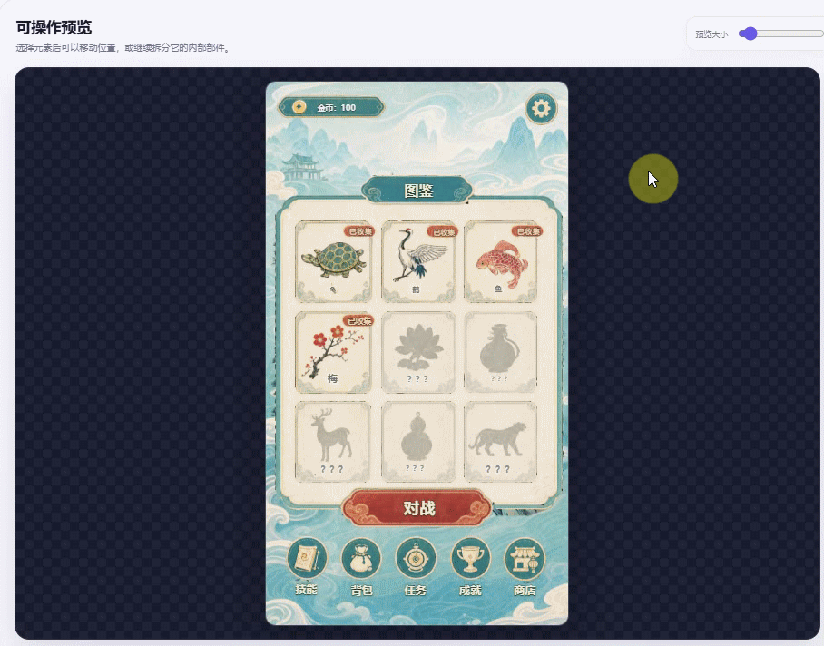

### 0.1 效果与交互

下图依次展示原图、修补后的干净背景、素材重新组合的还原预览。OCR 文字会被重新渲染，因此字体和字号可能与原图存在偏差，但文字独立成层是游戏 UI 编辑所需的结果。

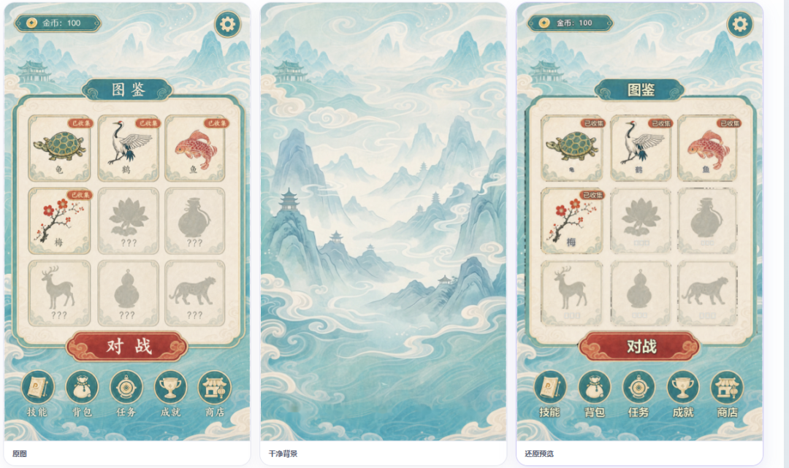

素材导出同时包含容器、按钮、卡片、图标、插画、徽标和文字层。被上层遮挡的面板或卡片会先补齐缺失材质，再作为完整素材导出。

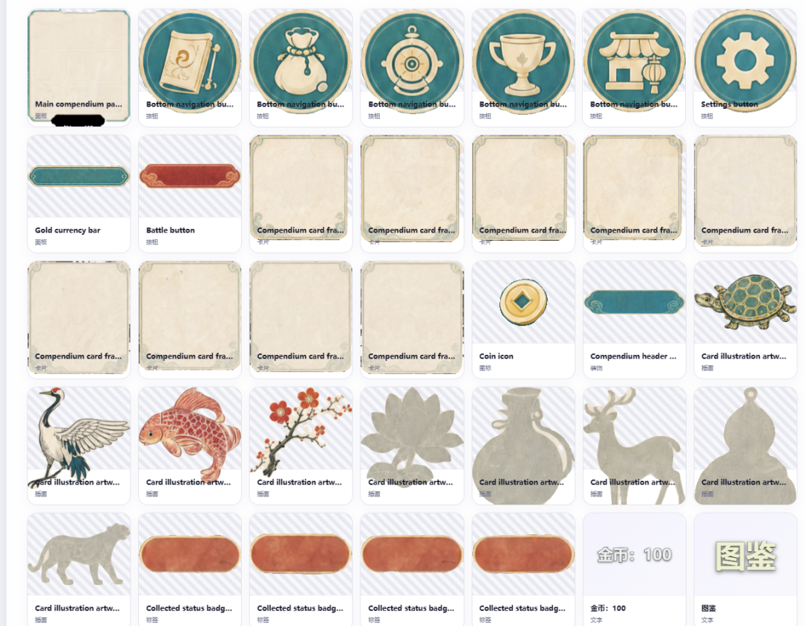

交互兜底包括：再次拆分当前素材、通过 Prompt 重新修补、画笔手动修复和单层下载。

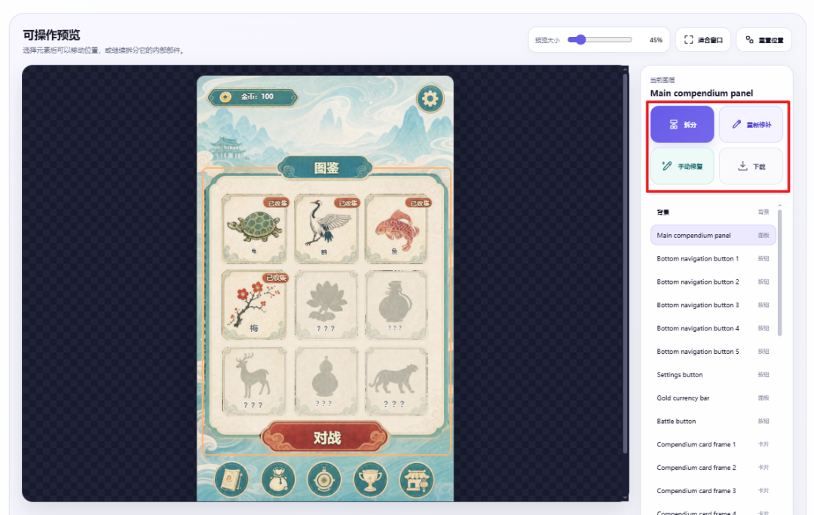

### 0.2 总流程

```text
输入 UI 预览图
  |
  +-- 1. OCR 文字提取
  |     RapidOCR，最低置信度 0.35
  |
  +-- 2. 初次全 OCR 去字
  |     字形估计 + OpenCV Telea inpaint
  |
  +-- 3. 主 LLM 调用
  |     原图 + 初次去字图 + OCR 稳定 ID + 图层规划 Prompt
  |       |
  |       +-- 文字处理分支
  |       |     +-- 二次文字处理：处理 LLM 发现的遗漏普通文字
  |       |     +-- 不重复运行去字：美术字不作为普通文字继续清除
  |       |
  |       +-- 4. 美术字处理
  |             删除对应文字 mask，恢复原图中的栅格字形并补发素材查询
  |
  +-- 5. SAM 逐实例分割
  |     SAM1 ViT-B；整图编码一次；逐提示输出三套候选
  |
  +-- 6. 图层构建与 mask 清理
  |     候选评分 + 3x3 闭运算 + 8 邻域连通域筛选
  |       |
  |       +-- 元素内部修补分支
  |       |     +-- image：大模型生图
  |       |     +-- surface：传统算法补材质
  |       |     +-- none：不做内部修补
  |       |
  |       +-- 背景修补分支
  |             +-- scene：大模型生图
  |             +-- surface：传统算法补表面
  |             +-- none：保留当前背景
  |
  +-- 7. 按父子关系和 z_order 组合
        输出背景、图片层、文字层和复原图
```

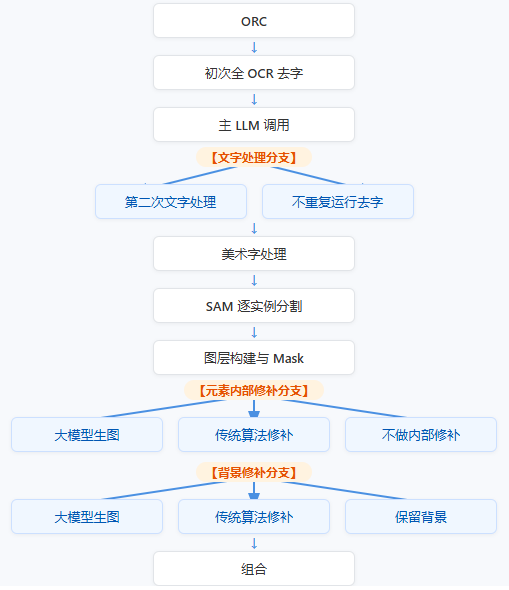

### 0.3 示例耗时

| 阶段 | 耗时 |
| --- | ---: |
| OCR 提取文字 | 4,133 ms |
| LLM 前初次全 OCR 去字 | 827 ms |
| LLM 图层规划 | 14,237 ms |
| SAM 分割及元素图层构建 | 19,804 ms |
| 背景修补 | 12,810 ms |
| 最终组合 | 63 ms |
| **总计** | **51,874 ms** |

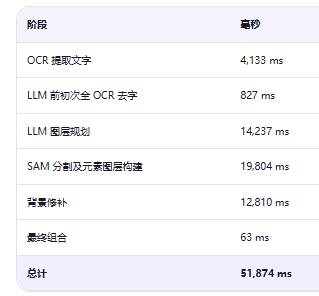

DOCX 正文称其中两个本地模型调用分别约为 **4.1 秒**和 **19.8 秒**，对应表中的 OCR 与 SAM 阶段，并提出迁移到云端 GPU 后把整体时间压缩到约 30 秒。原文没有给出测试硬件、并发数或生图模型名称，不能据此推导其他性能结论。

## 1. 文字处理

### 1.1 OCR 文字提取

- OCR 引擎：RapidOCR。
- 最低置信度：**0.35**。
- 单个拉丁字母低于 **0.85** 时，视为图标误识别并剔除。
- 低置信度且高宽比 **>= 2.4** 的竖排装饰候选剔除。
- 每条记录包含稳定 ID、文本、置信度和 OCR 四边形/bbox；全部有效区域合成全图文字 mask。

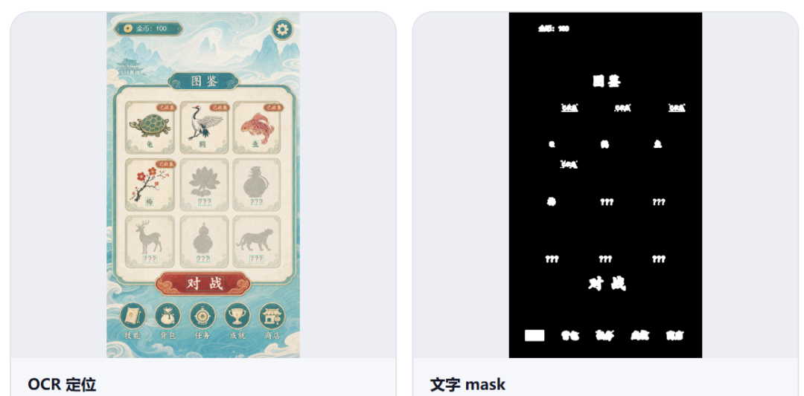

### 1.2 初次全 OCR 去字

初次阶段先清除所有 OCR 字形，得到供 LLM 和非文字分割使用的工作图。后续若 LLM 将某些 OCR ID 判为美术字，再从原图恢复对应区域。

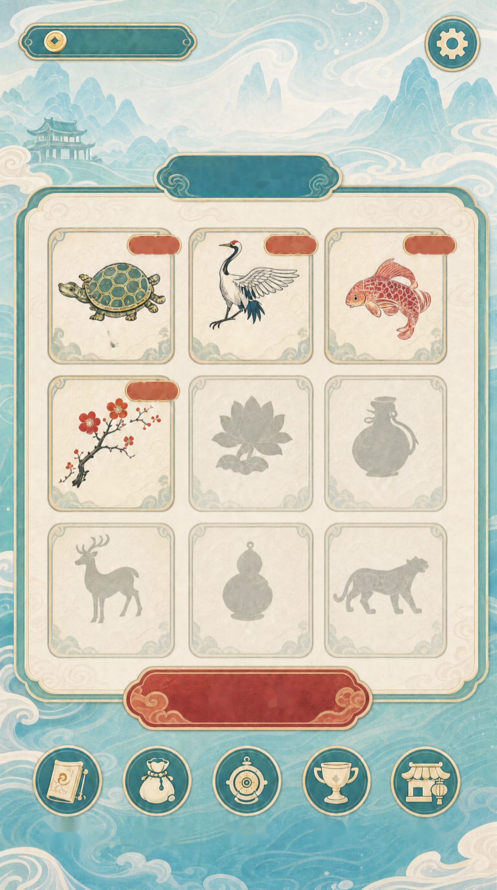

#### 1.2.1 单个 OCR 区域的算法

1. **限定候选范围**：截取 OCR bbox，把 OCR 四边形转换为局部 `allowed` mask。后续底色估计、像素分类和形态学操作均不得越出该四边形。
2. **估计局部底色**：从裁片四周取宽度 `clamp(min(h,w)/4, 1, 3)` 像素的边带，仅保留 `allowed` 内像素，计算 RGB 中位数 `B`。
3. **计算颜色距离**：对 `allowed` 内像素计算 `d(p)=||I(p)-B||_2`，把 `3d` 截断到 0 至 255。
4. **Otsu 分割字形**：在 `3d` 响应图上计算 Otsu 阈值 `T`；字形条件为 `3d >= max(12, 0.65T)`。
5. **连接笔画**：字形二值图执行一次 3x3 闭运算，连接笔画中的小裂缝。
6. **质量约束**：字形面积占 OCR 四边形小于 **1.5%** 或大于 **68%** 时，颜色分离不可信，改用完整 OCR 四边形作为 mask，记录 `mask_mode=coarse`；否则记录 `estimated_glyphs`。
7. **覆盖抗锯齿、描边和阴影**：按 OCR 框高 `h` 对字形 mask 做椭圆膨胀。单个中文字符半径为 `clamp(round(0.16h), 3, 8)`；其他文字为 `clamp(round(0.09h), 2, 6)`。所有区域取并集，形成硬 removal mask。
8. **Telea 修补**：原图 RGB 转 BGR，调用 `cv2.inpaint(image, mask, radius=5, INPAINT_TELEA)`，再转回 RGB。Telea 从 mask 边界向内推进，按已知像素与待补点的距离、边界法线和等照度线方向加权，主要延续文字附近的局部颜色和低频纹理。

#### 1.2.2 原文诊断图中的完整示例

以“图鉴”OCR 裁片为例：

| 中间量 | 示例值/结果 |
| --- | --- |
| OCR bbox | `[669, 495, 887, 600]` |
| 底色边带 | 3 px，仅 `allowed` 内像素参与 |
| RGB 中位底色 | `(60, 127, 139)` |
| Otsu 阈值 | `T=137`，在 `3d(p)` 响应上计算 |
| 字形面积占比 | `37.35%`，因此使用 `estimated_glyphs`，不回退 coarse mask |
| 实际字形图例 | 绿色表示闭运算后的候选字形，占 `allowed` 的 `37.35%` |
| OCR 框高 | `h=105 px` |
| 椭圆膨胀半径 | `6 px`；红色表示最终 removal mask，覆盖字缘、描边和阴影 |
| 最终待修像素 | `14,943` 个；白色修补，黑色保持 |
| 修补输出 | Telea cleaned RGB |

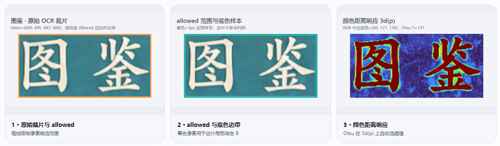

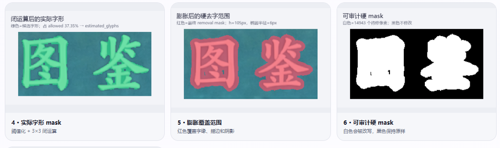

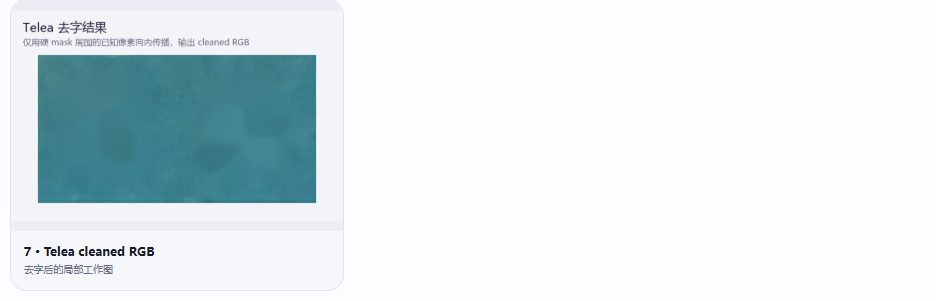

### 1.3 文字样式估计与渲染

OCR 只提供文本和位置。可编辑文字层还需要估计颜色、字体、字号、字重、描边和阴影。

| 属性 | 通用规则 |
| --- | --- |
| 前景色 | 字形 mask 内像素的每个 RGB 通道按 32 宽度量化到桶中心 `16,48,...,240`；颜色桶得分为 `像素数 x (24 + 与局部背景的 RGB 欧氏距离)`，取最高分桶 |
| 字体族 | 包含 CJK 字符使用 Microsoft YaHei，否则使用 Arial；这是可用字体映射，不代表识别出原始字体文件 |
| 字号 | 单个中文字符 `round(0.88h)`，其他文字 `round(0.82h)`，下限 8 px；PIL 测量含描边包围盒，若超过 OCR 框宽或框高，则逐像素减小到完整放入 |
| 字重 | `coverage = 字形mask像素数/(框宽 x 框高)`；`coverage >= 0.17` 输出 700，否则输出 600 |
| 描边颜色 | 分别以 Rec.709 `0.2126R+0.7152G+0.0722B` 计算前景和背景亮度；前景不暗于背景使用 `#1e2322`，否则使用 `#f0f4f1` |
| 描边宽度 | `coverage > 0.12` 时 `round(0.045h)`，否则 `round(0.03h)`，最终限制到 0 至 2 px |
| 阴影 | DOCX 只给出示例生成结果，没有给出完整通用公式；不得据示例臆造统一阴影算法 |

“金币：100”示例中的全部诊断值：

| 属性 | 示例中间值/输出 | 作用 |
| --- | --- | --- |
| 局部底色 | 边带 3 px；中位数 `RGB [70.0, 131.0, 130.0]`；Rec.709 亮度 `117.96` | 只参考文字框附近，避免把整张 UI 主色误作文字背景 |
| 前景色 | `#eff0f0`；亮度 `239.79` | 保留文字主色，避免抗锯齿/阴影单独成为颜色 |
| 字体族 | 命中 CJK，使用 Microsoft YaHei | 使用机器可用中文字体 |
| 字号 | `round(0.82h) -> 46 px`；实际 46 px；`fit-to-box=false` | 多字符文本按框高 0.82 倍估计，示例无需缩小 |
| 字重 | `26.79% >= 17%`，输出 700 | 覆盖率较高，使用粗体档 |
| 描边 | 亮度 `239.79 vs 117.96`；`round(0.045h)`；`h=56 px` 后限为 2 px；颜色 `#1e2322` | 亮前景配深描边，维持局部材质对比 |
| 阴影 | 不从原图猜方向；图中称“按 `h` 生成”，示例输出 `x=0, y=2, blur=3, #20282799` | 示例先画模糊阴影，再画描边和前景；原文未给出从 `h` 推导参数的通用公式 |

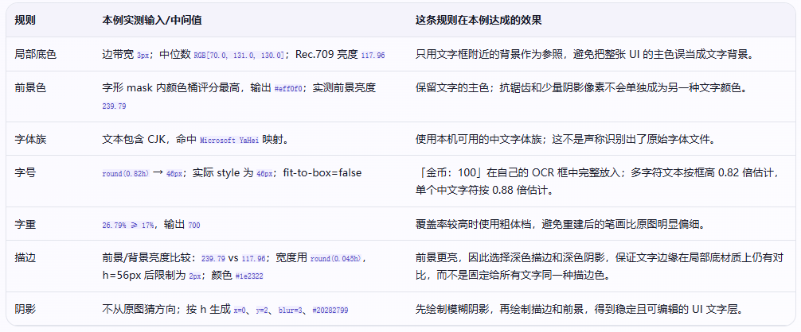

### 1.4 美术字分支

Logo、字标和装饰性展示字是像素素材，不应被普通字体重建；OCR 本身无法区分它们。流水线在 LLM 阶段执行渲染方式判断：

1. 初次工作图已移除全部 OCR 字形。
2. LLM 把普通可读 UI 文案保留为可编辑文本。
3. LLM 把不规则造型、多色填充、定制粗描边、嵌入吉祥物/图标或手绘几何构成身份特征的文字 ID 放入 `raster_text_ids`。
4. 对每个 `raster_text_id` 删除其文字 removal mask，从原图恢复该栅格字形。
5. 同时补发且只补发一个非文本素材查询，优先使用 `kind=logo, role=foreground`，使 SAM 在恢复后的工作图上切出完整美术字素材。
6. 不能仅因粗体、描边或文字位于按钮上，就判为美术字。

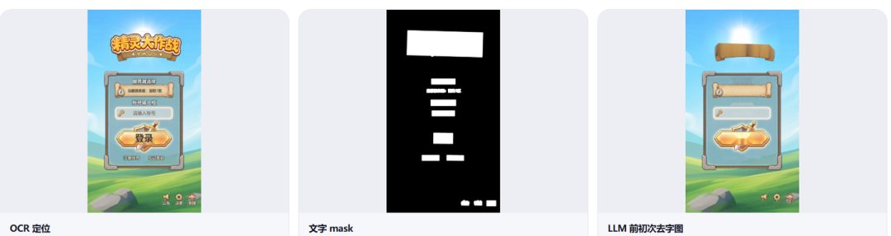

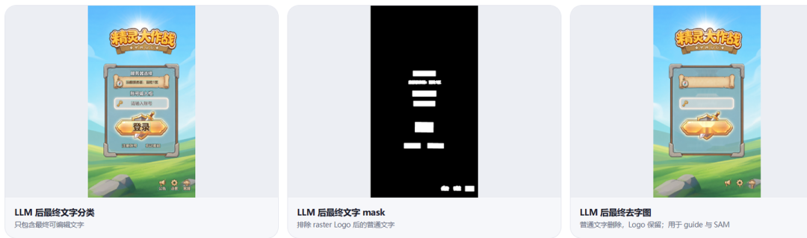

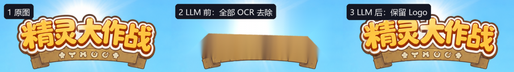

## 2. 素材分割

素材分割负责把预览图中的可编辑非文字对象拆为实例 mask。项目对多种分割模型和组合方式做过实验，最终采用 LLM 规划加 SAM 提示分割。

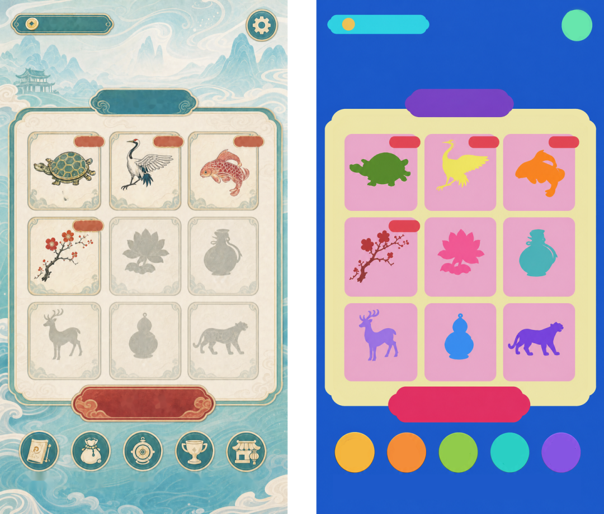

### 2.1 LLM 图层规划

- 模型：**Gemini 3.7 Flash**。
- 选择依据：原文描述为视觉能力、响应速度和推理能力的综合对比。
- 输入顺序：第一张原图，第二张初次全 OCR 去字图，再加带稳定 ID 的 OCR 区域列表和 Prompt。
- 原图仅用于文字审计；非文字图层规划以去字工作图为准。
- 输出职责：场景摘要、背景修补模式、OCR 漏识修正、美术字 ID、元素实例、类型/角色、修补模式、父子关系、z 顺序以及 SAM 几何提示。

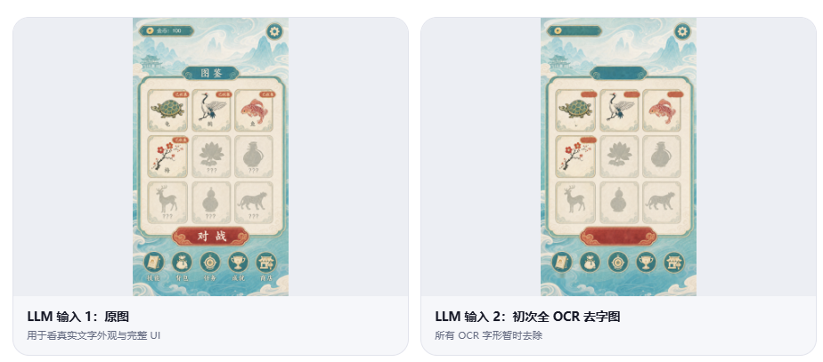

#### 2.1.1 返回 Schema

```jsonc
{
  "scene_summary": "short description",
  "background_repair": {
    "mode": "scene|surface|none",
    "reason": "short evidence-based reason"
  },
  "text_corrections": [{"text": "visible text missed by OCR", "bbox_norm": [0.1,0.1,0.2,0.2], "confidence": 0.8}],
  "raster_text_ids": ["text_001"],
  "queries": [{
    "id": "snake_case_id",
    "name": "short user-facing name",
    "kind": "panel|card|button|icon|illustration|badge|decoration|logo",
    "role": "container|surface|button|foreground|decoration",
    "element_repair_mode": "image|surface|none",
    "parent_query_id": null,
    "z_order": 0,
    "geometry_hints": [{
      "bbox_norm": [0.1,0.1,0.2,0.2],
      "positive_points_norm": [[0.15,0.15]],
      "negative_points_norm": []
    }]
  }]
}
```

#### 2.1.2 图层、几何和修补决策

- **必须输出**：材质/边界可见的大面板、板块、边框、对话框；每个重复卡片/槽位/标签页/行表面；含集成图标的完整操作/导航按钮；独立图标、物品插画、肖像、剪影、带框插画；有自身形状的徽章、缎带、锁、计数器和成组状态标记。
- **不得输出**：全屏背景、普通文字、阴影、空隙、分隔线、推测对象、重复复合描述、带框插画内部的人物或道具。
- **父子拆分条件**：父表面和前景子元素都是真实可编辑资产时才分别导出。
- **重复实例**：共享一个 query，但每个实例有独立 `geometry_hints`，不得机械复制相同相对点位。
- **bbox**：`bbox_norm=[x0,y0,x1,y1]` 归一化至 0..1，紧密且只包围一个实例。
- **正点**：1 至 3 个，位于目标实体像素，不能位于边缘、孔洞或背景。
- **负点**：默认空；仅存在真实竞争对象时使用 1 至 2 个点。不能把底层表面承载的叠加子元素标作负点。
- **z_order**：从后到前，父表面 z 值小于子元素。
- **parent_query_id**：指向最近直接材质父级，不是简单指向最大外层面板。卡内插画/剪影/徽章/标签属于卡，卡属于面板；只有根元素为 `null`。父子链同时用于导出和遮挡修补。
- **element image**：带纹理、图案、插画、半透明、渐变、光晕的父材质，由图像模型重建。
- **element surface**：仅用于近似均匀纯色材质，使用测得周边像素重建。
- **element none**：最上层对象，或子元素后方没有需要恢复的材质。
- **background scene**：真实纹理/插画场景，根据可见边界重建；输入只有黑色诊断孔和极窄软边。
- **background surface**：均匀或半透明材质，仅延续边界颜色和低频成分，不虚构场景纹理。
- **background none**：不合成隐藏像素。所有模式按图像证据选择，不能按图层数量选择。

#### 2.1.3 LLM 图层规划完整英文 Prompt

```text
Analyze a game UI and return a compact executable layer plan.

Two images are provided in this order: (1) the original image, (2) an OCR-cleaned working image.

OCR regions are listed with stable ids below. First classify their rendering mode:
- ordinary readable UI copy (labels, values, hints, button captions) remains editable text;
- a logo, wordmark or decorative display lettering whose irregular shape, multicolor fill, thick custom outline, embedded mascot/icon or hand-drawn geometry is part of its identity must remain a raster image asset. Put only those OCR ids in raster_text_ids.

Do not classify text as raster merely because it is bold, outlined or placed on a button. A normal font that can be acceptably recreated as text must stay editable. This is a rendering decision, not an OCR-confidence decision.

The cleaned image initially has all OCR glyphs removed. For each raster_text_id, also emit exactly one non-text query (prefer kind=logo, role=foreground) using its location in the original image. The pipeline will restore that artwork before segmentation. Never emit ordinary text as a query.

Find all visible non-text assets that should be independently editable:
- large panels, boards, frames and dialogs whose exposed material/boundary is visible;
- every repeated card, slot, tab or row surface as a separate geometry hint;
- complete action/navigation buttons as one object, including any integrated icon shape;
- independent icons, item artwork, portraits, silhouettes and framed illustrations;
- badges, ribbons, locks, counters and grouped status markers with their own visible shape.

Do not emit the full-screen background, ordinary text, shadows, gaps, separators, speculative objects, duplicate composite descriptions, or people/props inside one framed illustration. A parent surface and its foreground child must be separate only when both are real editable assets. Repeated instances share one query but each instance needs its own hint.

Every hint is passed directly to segmentation:
- bbox_norm=[x0,y0,x1,y1] tightly encloses exactly one instance, normalized to 0..1;
- positive_points_norm has 1-3 points on solid target pixels, not edges, holes or background;
- negative_points_norm is empty unless a real competing object is near/inside the box; when used, put 1-2 points on that competitor, never on an overlaid child of an underlying surface;
- inspect each repeated instance separately. Do not mechanically copy relative point positions.
- z_order is back-to-front. Parent surfaces must have a lower z_order than their children.
- parent_query_id is required for every element visually carried by another exported element. Use the nearest direct material parent, not merely the largest outer panel: artwork, silhouette, badge or label inside a card belongs to that card; the card belongs to its panel. Leave it null only for true root elements. This parent chain is exported and also controls occlusion repair.

For every query choose one element_repair_mode:
- "image" for a textured, patterned, illustrated, translucent or gradient-bearing parent material whose child elements must later be removed and reconstructed by the image model;
- "surface" only for a nearly uniform flat-colour material that can be reconstructed from measured neighbouring pixels;
- "none" for a topmost foreground object or an object with no meaningful material behind children.

This is a material decision. A panel/card/frame with artwork, glow or visible texture is "image".

Choose one background_repair.mode for the pixels hidden by the extracted UI:
- "scene": the hidden area is a real textured/illustrated scene and should be reconstructed from the visible scene boundary. The repair image will contain only a black diagnostic hole plus a very narrow softened edge; do not rely on a generated prefill.
- "surface": the hidden area is visually close to a uniform or translucent colour/material. Use measured boundary colour/low-frequency continuation only; do not invent scenery or texture.
- "none": do not synthesize hidden pixels; preserve the current cleaned background.

Select from the image evidence, not from the number of detected layers.

Return JSON only, with no prose and no fields outside this schema. The original image is provided only for the text audit; the text-cleaned image is the source for non-text layer planning.

{
  "scene_summary": "short description",
  "background_repair": {"mode": "scene|surface|none", "reason": "short evidence-based reason"},
  "text_corrections": [{"text": "visible text missed by OCR", "bbox_norm": [0.1,0.1,0.2,0.2], "confidence": 0.8}],
  "raster_text_ids": ["text_001"],
  "queries": [{
    "id": "snake_case_id",
    "name": "short user-facing name",
    "kind": "panel|card|button|icon|illustration|badge|decoration|logo",
    "role": "container|surface|button|foreground|decoration",
    "element_repair_mode": "image|surface|none",
    "parent_query_id": null,
    "z_order": 0,
    "geometry_hints": [{"bbox_norm": [0.1,0.1,0.2,0.2], "positive_points_norm": [[0.15,0.15]], "negative_points_norm": []}]
  }]
}
```

> **实现偏差（2026-09-02，run 9bf549dd 诊断后用户裁定）**：上文官方 Prompt 的
> "Do not emit the full-screen background…" 与素材清单两条对游戏 UI 粒度不够——实测规划只给
> 10 个粗查询：顶部地物/植被无查询、卡片整卡一个查询（无框/内容父子）、时间轴竖线+全部圆节点
> 一个查询。实现已在 `algorithm/planner/prompt.py` 的 PLANNER_PROMPT 中于素材清单后增补
> **Game-UI decomposition rules**（通用规则，非样例特化）：①卡片/面板有可分离内容时必须拆
> "框 + 内容"父子查询（内容铺满框也要拆：框环一层、内层画作一层），子层的 bbox/mask 必须
> 在框环以内、不含装饰框（2026-09-03 补），框按材质选 surface/image 修补模式；②长结构线
> （时间轴/轨道/连线）单独一个查询，沿线重复节点图标另开查询逐实例给
> hint；③**通用压叠规则**：任何一个已提取元素压在/压过另一个已提取元素上（节点压线、徽章压
> 面板角、丝带压卡片、锁扣压槽位……），上层元素的 parent_query_id 指向被压的下层，下层在被
> 压住处自动镂空修补；④背景内显著独立的装饰簇提为 decoration 查询，每个独立簇一条（左侧
> 山体群与右侧树丛是两条，不是一条横带），仅弥漫性全幅纹理（纸纹/渐变/雾气）留在背景。
> 另有与提示词无关的确定性兜底：`repair/elements.py` 对无树关系但 mask 显著重叠的实例对
> （≥24px 且 ≥较小面积 5%）按 z/面积推定上下并自动镂空底层，planner 漏声明父子也能修；
> 子层 mask 混进框环时按几何剥离（`_clip_children_to_frames`，见 §3.1 偏差注记）。
> 另把 background scene 描述中"黑色诊断孔"改为"平涂占位色孔"（与 2026-09-01 起的预填实现
> 一致）。

#### 2.1.4 DOCX 中的中文译文

```text
分析游戏 UI，并返回一份紧凑、可执行的图层规划。

系统按顺序提供两张图片：1. 原始图片；2. 经 OCR 清理后的工作图片。

下面列出带稳定 ID 的 OCR 区域。普通可读 UI 文本（标签、数值、提示语、按钮文字）保留为可编辑文本；Logo、字标或装饰性展示字体，如果其不规则造型、多色填充、粗重定制描边、嵌入式吉祥物/图标或手绘几何构成身份特征，则保留为栅格资产，只有这类 OCR ID 放入 raster_text_ids。

不能仅因文字粗体、描边或位于按钮上就判为栅格。普通字体可以接受地重建时必须保留为可编辑文本。这是渲染方式判断，不是 OCR 置信度判断。

清理图初始已移除全部 OCR 字形。每个 raster_text_id 必须基于原图位置输出且仅输出一个非文本查询，优先 kind=logo、role=foreground；流水线在分割前恢复它。普通文字不能创建 query。

输出对象包括：材质/边界可见的大型面板、板块、边框、对话框；每个重复卡片、槽位、标签页、行表面；含集成图标的完整操作/导航按钮；独立图标、物品插画、肖像、剪影、带框插画；有独立形状的徽章、缎带、锁、计数器和成组状态标记。

不要输出全屏背景、普通文字、阴影、空隙、分隔线、不可确认的推测对象、重复复合描述或带框插画内部人物/道具。父表面与前景子元素都是真实可编辑资产时才分别导出。重复实例共享 query，但各有自己的几何提示。

bbox_norm 紧密且只包围一个实例并归一化至 0..1；positive_points_norm 为 1 至 3 个实体内部点；negative_points_norm 默认空，只在真实竞争对象上放 1 至 2 个点，不能放在底层表面承载的上层子元素上。逐个检查重复实例，不能机械复制点位。

z_order 从后到前，父级低于子级。parent_query_id 指向最近直接材质父级：卡内插画、剪影、徽章、标签属于卡，卡属于面板；只有根元素为 null。父子链会导出并控制遮挡修补。

element_repair_mode：image 用于纹理、图案、插画、半透明或渐变父材质；surface 仅用于近似均匀纯色材质；none 用于最上层对象或子元素后没有有意义材质的对象。带插画、光晕或明显纹理的面板、卡片、边框使用 image。

background_repair.mode：scene 根据可见边界重建真实纹理/插画场景，修复输入仅有黑孔和极窄软边；surface 只延续均匀/半透明材质的边界颜色和低频成分；none 保留当前背景。必须按图像证据选择，不能按图层数量选择。
```

DOCX 中文译文到此注明“返回 JSON 格式部分略”；完整 JSON Schema 已在 §2.1.1 和英文 Prompt 末尾逐字段保留。

#### 2.1.5 示例规划结果

原文截图把归一化提示转换成示例任务的像素框和像素正点。以下值只说明结构，不是固定常量；示例负点全部为空。

| 实例 | 类型/角色 | 父级 | Z | 像素框 | 正点 | 修补 |
| --- | --- | --- | ---: | --- | --- | --- |
| `coin_bar` | panel/container | 根图层 | 1 | `[54,69,611,195]` | `[[384,132]]` | surface |
| `settings_button` | button/button | 根图层 | 1 | `[1309,52,1485,223]` | `[[1398,138]]` | none |
| `main_panel` | panel/container | 根图层 | 1 | `[37,570,1499,2160]` | `[[92,1376]]` | image |
| `panel_header_tab` | badge/container | 根图层 | 2 | `[470,468,1066,627]` | `[[768,545]]` | surface |
| `card_slot #1` | card/container | `main_panel` | 2 | `[143,699,544,1126]` | `[[338,1046]]` | image |
| `card_slot #2` | card/container | `main_panel` | 2 | `[581,699,963,1126]` | `[[768,1046]]` | image |
| `card_slot #3` | card/container | `main_panel` | 2 | `[997,699,1385,1126]` | `[[1198,1046]]` | image |
| `card_slot #4` | card/container | `main_panel` | 2 | `[143,1156,544,1582]` | `[[338,1514]]` | image |
| `card_slot #5` | card/container | `main_panel` | 2 | `[581,1156,963,1582]` | `[[768,1514]]` | image |
| `card_slot #6` | card/container | `main_panel` | 2 | `[997,1156,1385,1582]` | `[[1198,1514]]` | image |
| `card_slot #7` | card/container | `main_panel` | 2 | `[143,1613,544,2039]` | `[[338,1954]]` | image |
| `card_slot #8` | card/container | `main_panel` | 2 | `[581,1613,963,2039]` | `[[768,1954]]` | image |
| `card_slot #9` | card/container | `main_panel` | 2 | `[997,1613,1385,2039]` | `[[1198,1954]]` | image |
| `collected_badge #1` | badge/foreground | `card_slot` | 3 | `[390,721,559,787]` | `[[476,754]]` | none |
| `collected_badge #2` | badge/foreground | `card_slot` | 3 | `[811,721,980,787]` | `[[891,754]]` | none |
| `collected_badge #3` | badge/foreground | `card_slot` | 3 | `[1243,721,1407,787]` | `[[1321,754]]` | none |

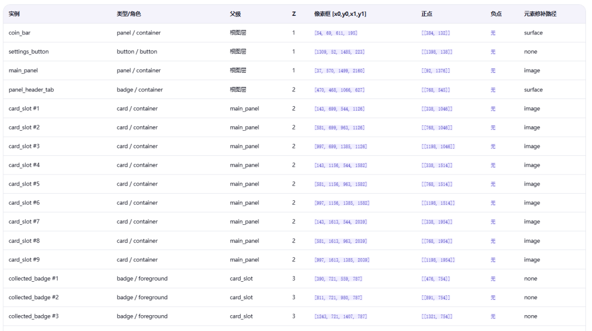

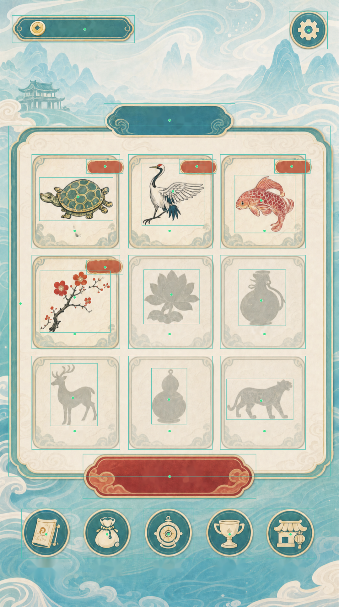

### 2.2 SAM 提示分割

- 模型：Segment Anything **SAM1 ViT-B**。
- 一张任务图只执行一次图像编码。
- 每个 LLM 几何实例分别传入 bbox、正点和可选负点。
- SAM 为每个实例返回三套候选 mask 和模型分。

### 2.3 三候选评分

```text
总分 = SAM模型分 + 0.22 x 正点命中率 - 0.38 x 负点命中率
     + 0.10 x 框内包含度 + 0.06 x 外接框IoU
```

正点命中率衡量候选是否覆盖锚点；负点命中率衡量是否误吞竞争对象；框内包含度是候选 mask 位于提示框内的比例；外接框 IoU 衡量候选范围与提示框的一致性。

| 候选 | SAM 分 | 正点 | 负点 | 框内包含度 | bbox IoU | 总分 | 决定 |
| --- | ---: | ---: | ---: | ---: | ---: | ---: | --- |
| 1 | 0.9833 | 1.0 | 0.0 | 0.9956 | 0.9780 | **1.3615** | 选中 |
| 2 | 0.9565 | 1.0 | 0.0 | 0.9958 | 0.9735 | **1.3345** | 舍弃 |
| 3 | 0.9050 | 1.0 | 0.0 | 0.9966 | 0.9798 | **1.2835** | 舍弃 |

候选 3 的 bbox IoU 最高，但 SAM 模型分较低，综合评分仍选择候选 1。

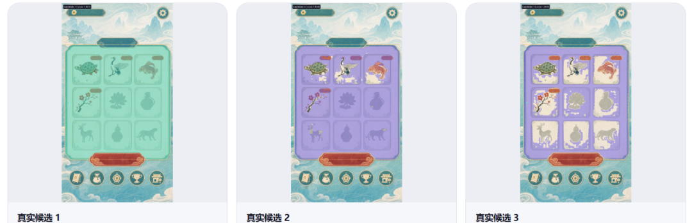

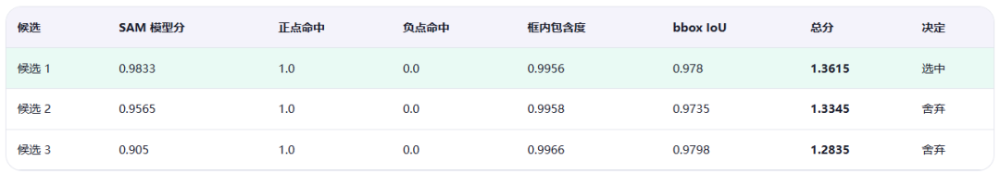

### 2.4 mask 修补与连通域筛选

1. 对二值 mask 使用 3x3 全 1 核，先膨胀 1 px，再腐蚀 1 px。闭运算连接约 1 至 2 px 断裂并填小针孔，但不把大洞补成矩形，也不扩张成 bbox。
2. 按 8 邻域划分连通组件。
3. 所有包含正点的组件必保留。
4. 若没有组件命中正点，保留最大组件。
5. 另保留面积至少为最大组件 **8%** 的组件。
6. 删除小于阈值且不含正点的孤立碎屑。

原文诊断图依次展示 SAM 原始二值 mask、闭运算与连通域筛选后的 mask，以及组件去留示意；第三幅图中绿色表示保留组件，红色表示删除组件。

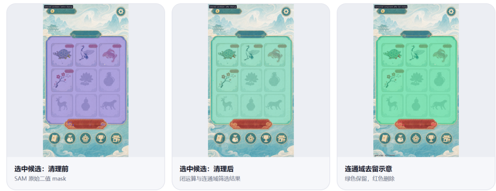

上述过程对所有实例重复，形成图片层 mask、坐标和父子关系。

## 3. 遮挡与材质修补

顶层对象没有被其他层遮挡，可直接提取；底层对象扣除子元素/前景对象后出现黑色镂空，必须按 LLM 材质决策修补。

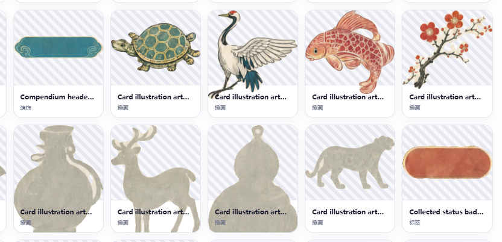

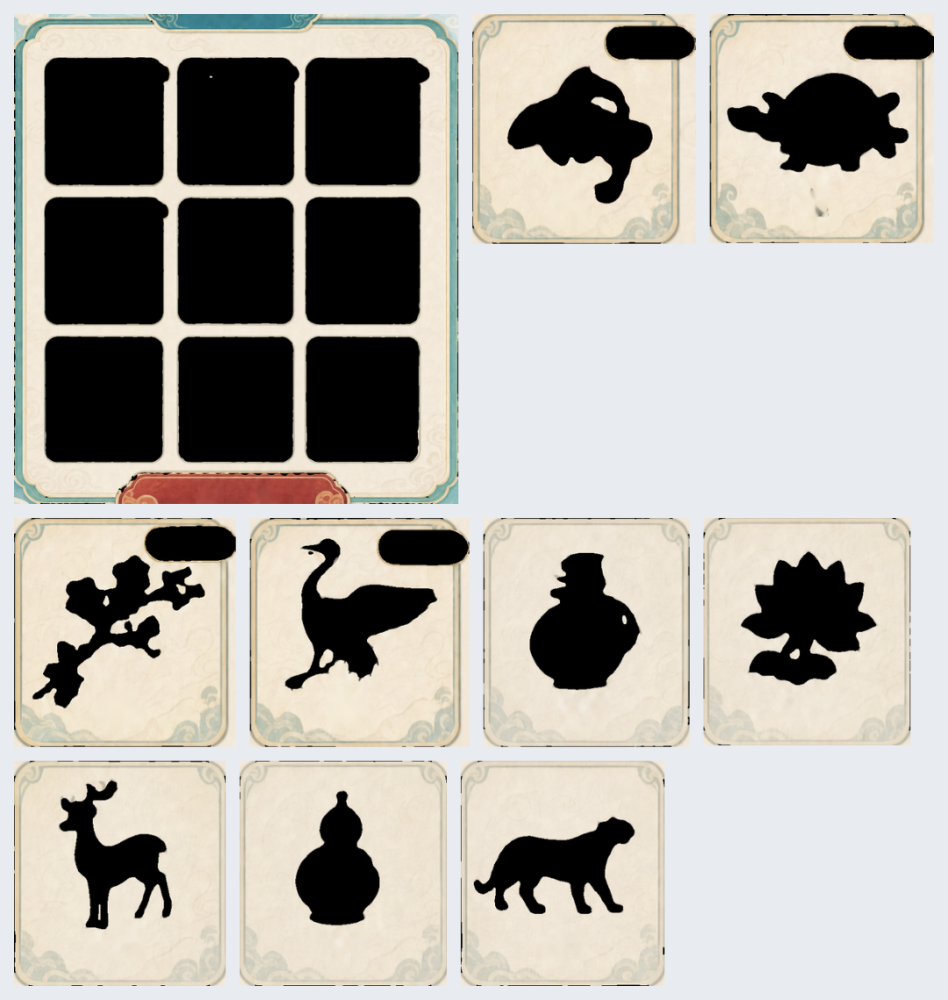

### 3.1 `element_repair_mode=image`：Atlas 生图修补

把所有需生图修补的元素按自适应原始比例拼成 Atlas，同时生成同尺寸二值 mask；一次生图调用返回修补后的 Atlas，再按布局切回各元素。

```text
Image inpainting task. The first image is the Atlas to be repaired, and the second image is a binary mask of exactly the same dimensions.
All white regions in the mask must be inpainted, while all black regions in the mask must remain unchanged. Black areas in the first image also represent missing content. The repaired content must seamlessly continue the surrounding background material of the same element.
The black regions are not black content to preserve, nor are they text to be redrawn.
Repair only the black regions in the first image. Do not introduce any text, numbers, letters, icons, buttons, characters, objects, logos, lighting effects, or additional UI elements.
Use only the immediately adjacent background of the same element as reference. Fill the missing regions with continuous colors, gradients, translucent materials, and textures. Do not reference other elements.
All non-black content, element positions, dimensions, shapes, outer contours, boundaries, gray spacing, and the overall layout must remain completely unchanged.
Even if a black region has the shape of text, treat it solely as a gap in the parent layer's background. Do not restore it as text or as a rectangle.
Output a complete image with exactly the same dimensions as the input.
```

中文译文：

```text
图像修补任务。第一张图是待修补的 Atlas，第二张图是与它尺寸一致的二值 mask。
mask 中白色区域必须修补，黑色区域必须保持不动。第一张图中黑色也代表缺失内容，修补后的内容必须是同一个元素周围连续的背景材质。
黑色区域不是要保留的黑色，也不是要重新绘制的文字。
只修补黑色区域；不要出现文字、数字、字母、图标、按钮、角色、物体、Logo、光效或任何额外 UI 元素。
只参考黑色区域紧邻的同一元素背景，补成连续颜色、渐变、半透明材质和纹理，不参考其他元素。
所有非黑色内容、元素位置、大小、形状、外轮廓、边界、灰色间隔和整张图布局保持不动。
黑色区域即使是文字形状，也只是父层背景空缺，不还原成文字或矩形。
输出与输入完全相同尺寸的完整图像。
```

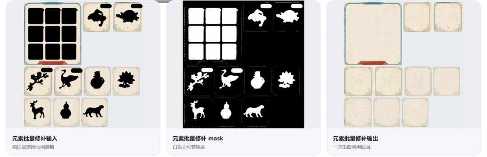

> **实现（切回，与背景 scene 同一约定）**：`slice_back` 按装箱位置把生图 Atlas
> 整块切回，即为各元素 PNG。涂黑 Atlas 只当输入并分文件落 debug
> （`05_atlas_input.png` / `05_atlas_mask.png`），`05_atlas.png` 是生图输出。
> 不按洞贴回原裁片，不做接缝融合或洞填后处理。只送涂黑图，不另送 mask。

### 3.2 `element_repair_mode=surface`

传统路径从缺口周围的同一元素像素估计并填充材质，适用于近似均匀单色平面。原文只说明它与文字清除修补相似并获取 mask 周围像素填补，没有给出独立采样半径、插值公式或是否直接复用 Telea，不能自行补写。

### 3.3 `element_repair_mode=none`

最上层对象或子元素背后没有有意义材质的对象不做内部修补。

### 3.4 背景修补

`scene` 路径先把 UI 隐藏区挖成黑色诊断孔。硬 mask 定义完整替换范围；软 mask 只在边缘参与结果融合，缓和接缝；生图输出必须延续可见场景且不得重建 UI。

> **实现（2026-09-03，文档 image25/26）**：待补区涂黑（不是中位色平涂），硬 mask
> （白=待补）作为第二张图始终送出。中位色预填且不送 mask 时，模型会把矩形占位
> 当成独立画框（job 9bd4d1c0 幽灵框）。`MAGICLAYER_BG_ATTACH_MASK=0` 可关掉掩膜；
> `MAGICLAYER_BG_PROMPT=short` 改短中文。元素 Atlas 同样涂黑+送掩膜。
> 遮罩极性默认按"不透明=待修补"编码。送出前洞区外扩 2px 吞残边，融合后做接缝带平滑。
> 低频锚定默认关（`MAGICLAYER_BG_ANCHOR=0`）；Grok 无 `b64_json` 时
> `openai_compat.generate_image_edits` 下载 `data[0].url`。
>
> **历史（probe-bg-r1）**：在中位色预填前提下，本地 gpt-image / grok-imagine-edit
> 曾走不送 mask。该组合已被涂黑+送 mask 取代，不要再按那张接口表配生产。

```text
Fill the black missing region in this image so the surrounding scene continues naturally.
Keep visible characters and objects, and naturally continue anything that reaches the black region.
Do not add UI, text, logos, or unrelated objects. Return one complete image at the same size.
```

中文译文：

```text
填充图像中的黑色缺失区域，使周围场景自然连续。
保留可见的人物和物体，并自然延续进入黑洞的内容。
不要添加 UI、文字、Logo 或无关物体。返回一张尺寸完全相同的完整图像。
```

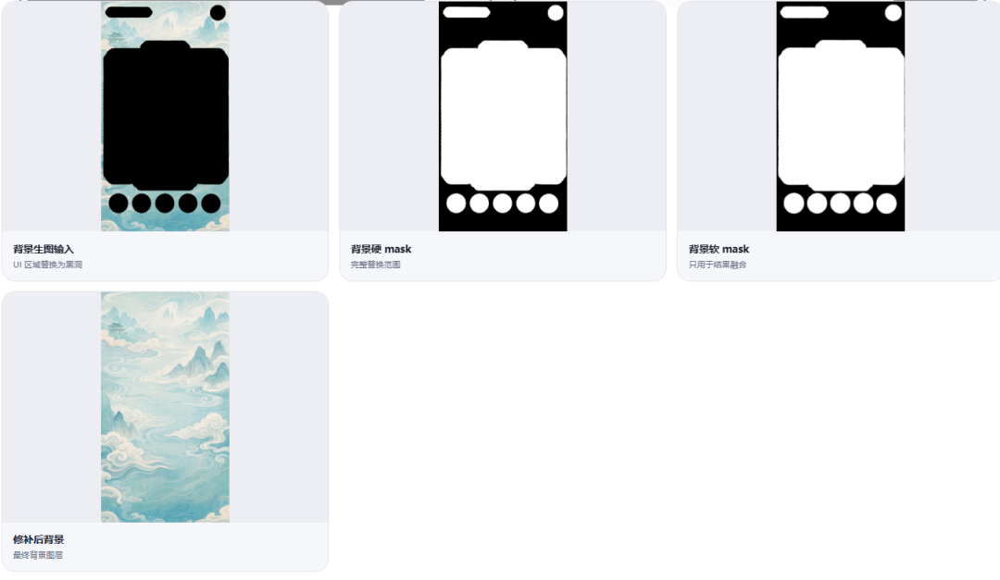

`surface` 背景分支只延续测得边界颜色/低频材质；`none` 不合成隐藏像素。DOCX 未给出这两条分支的进一步数值实现。

## 4. 图层组合

最终按素材坐标、`parent_query_id` 和从后到前的 `z_order` 组合：先放修补背景，再放根容器、卡片/面板子层、前景插画/徽章/按钮，最后渲染文字层。父子关系同时决定场景树归属和遮挡顺序。

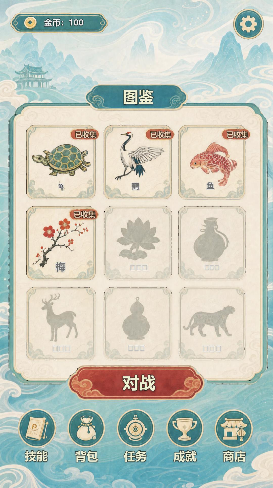

## 5. 对比实验与定位

### 5.1 qwen-image-layered

- 需要手动指定层数；层数不合适时结果明显变差。
- 显存占用高，运行速度慢。
- 合理设置层数并后处理后效果会提升，但拆图逻辑仍不够合理。
- 对复杂背景和其他测试图的泛化效果不佳。

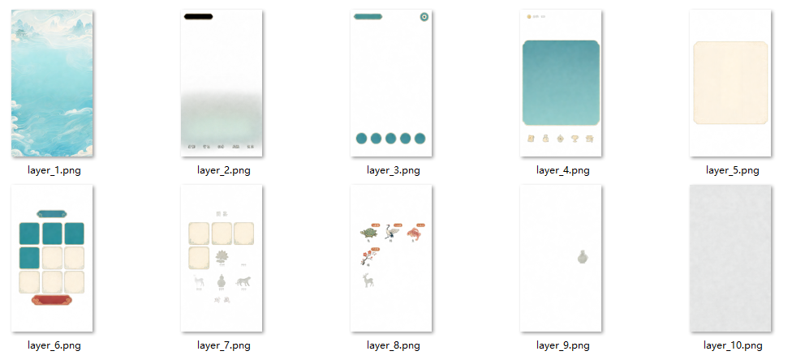

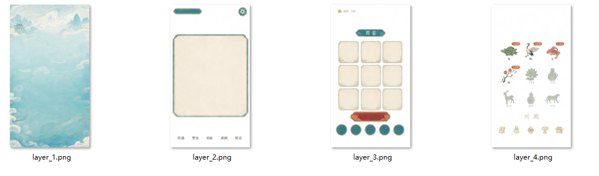

### 5.2 Canva Magic Layers

Magic Layers 拆分效果较好，但产品不支持批量下载全部元素。DOCX 只展示结果，不记录其内部算法，不应从输出反推或捏造实现。

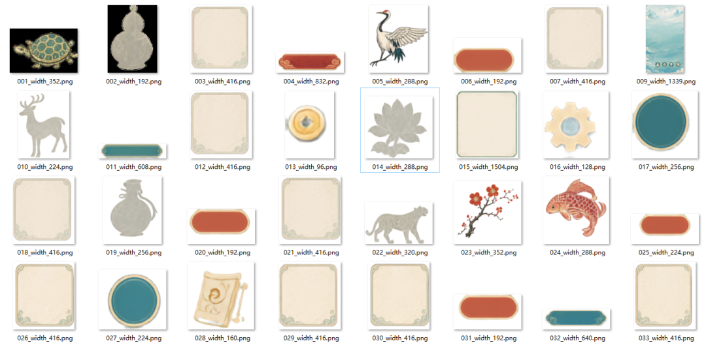

### 5.3 当前算法定位

当前方案以约 85% 自动拆分准确度为工程目标，不追求一次生成完全无瑕；产品通过二次拆分、Prompt 修补、画笔修补和单层下载处理剩余情况。

## 6. 后续改进

1. 依据 LLM 对图像类型和材质的决策，为不同图像选择不同提示词，提高泛化能力。
2. 通过图像相似度匹配召回参考图，使切分和补图更精准。

DOCX 未定义参考图库、相似度模型、召回阈值、Prompt 路由规则或评测集，这些不能当作当前算法既有能力。

## 7. 原文未定义、不得臆造的实现

- Atlas 元素修补和背景修补的具体生图模型、采样参数、随机种子和推理分辨率。
- `surface` 元素/背景修补的独立采样半径、插值公式及其是否复用 Telea。
- 硬 mask 到软 mask 的精确羽化核、半径和 alpha 融合公式。
- `text_corrections` 二次文字处理的 OCR 合并阈值和冲突规则。
- 阴影参数从框高 `h` 推导的完整公式；DOCX 只给一个实例值。
- 测试硬件、显存、并发、冷启动和模型缓存条件。
- 图像相似度参考图召回方案和评估指标。

这些缺口应由代码、实验或新增证据补齐，不能从图片效果猜测。
